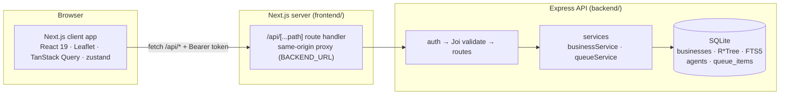

# Prospect Map Search · Sales Cockpit

A working prototype of a **Map Search** view for TELUS business sales agents. It shows businesses in the visible map area, lets an agent review a business at a glance, and add promising prospects to a personal, prioritised work queue. A lead claimed by one agent can't be claimed by another.

```
proj-map/
├── backend/            Node 20 · Express · Joi · SQLite (better-sqlite3) · port 4000
├── frontend/           Next.js 16 · React 19 · TypeScript · Tailwind · Leaflet · port 3000
├── docker-compose.yml
├── README.md
└── DESIGN_NOTES.md     UX decisions, trade-offs, what was cut, what changes for production
```

---

## Quick start

### Option A: Docker (one command)

```bash
docker compose up --build
```

Open http://localhost:3000. The backend seeds 500 mock businesses into a named volume on first start.

### Option B: Local (Node ≥ 20.9)

Two terminals:

```bash
cd backend && npm install && npm run dev        # http://localhost:4000 (auto-seeds on first run)
```

```bash
cd frontend && npm install && npm run dev       # http://localhost:3000
```

`npm run seed` (backend) resets the database to the deterministic demo dataset at any time.
The frontend reaches the backend through `BACKEND_URL` (default `http://localhost:4000`).

### Tests, lint, build

```bash
cd backend && npm test             # 63 API/service/domain tests (vitest + supertest, in-memory SQLite)
cd frontend && npm test            # 14 UI/state tests (vitest + Testing Library)
cd frontend && npm run test:e2e    # 43 end-to-end user-flow tests (Playwright, real stack)
cd frontend && npm run lint && npm run build
```

`npm run test:e2e` starts its **own isolated stack**: a backend on :4100 with a freshly seeded `backend/data/e2e.db`, and a production build of the frontend on :3100. Your dev servers and dev database are untouched. It drives the locally installed Chrome (no browser download). On a machine without Chrome, run `npx playwright install chromium` and set `PW_CHANNEL=chromium`. `npm run test:e2e:report` opens the HTML report, and failed tests keep a trace and screenshot in `frontend/test-results/`.

### Option C: Deploy on Render (free plan)

[`render.yaml`](render.yaml) is a Render **Blueprint** that creates both services from this repo, using each folder's Dockerfile:

| Service | Folder | Health check | Notes |
|---|---|---|---|
| `prospect-map-api` | `backend/` | `/api/health` | Auto-seeds 500 demo businesses on start |
| `prospect-map-web` | `frontend/` | `/` | `/api/*` proxies to the API's public URL (`BACKEND_HOST` is injected from the API's `RENDER_EXTERNAL_HOSTNAME`) |

1. Push this repo to GitHub.
2. In Render, choose **New → Blueprint**, connect the repo and pick `render.yaml`, then **Apply**. Both services build in parallel; the first build takes about 5–10 minutes.
3. Open the `prospect-map-web` URL.

Each service redeploys only when its own folder changes (`buildFilter`).

**Free-plan behaviour**
- Services sleep after about 15 minutes idle. The first visit wakes the web app, which then wakes the API, so allow about a minute. The UI shows a "Waking up the server…" notice, and the proxy waits up to 70 seconds (`BACKEND_TIMEOUT_MS`).
- There's no persistent disk on free instances. The API re-seeds the demo data each time it starts (every deploy or wake-up), so queue changes don't survive. To keep them, switch `prospect-map-api` to `plan: starter` and add `disk: { name: data, mountPath: /data, sizeGB: 1 }`.
- Free instances can't receive private-network traffic, so the web app reaches the API over HTTPS on its public URL.

**Troubleshooting:** if the web app shows "prospect service is unreachable", check `BACKEND_HOST` on `prospect-map-web`; it should be the API's `*.onrender.com` hostname. You can also set `BACKEND_URL=https://<api-host>` instead, which takes precedence.

---

## 2-minute demo script

1. **Scan the area.** Each business is a **score tag** on a muted (greyscale) map, like a price tag on a property map: an industry glyph tinted by lead tier (🟠 hot ≥ 75, 🟡 warm, 🔵 cool) plus the lead score. The tag fills in when hovered or selected; ★ means it's in your queue, and grey with a lock means another agent claimed it. Clusters are white discs with a tier-coloured ring and a **green badge counting the hot leads inside**, so you know where to zoom. Pins spiderfy at max zoom. The layers button switches to a colour map.
2. **Narrow it.** The top toolbar holds the keyword search and filter pills: _Industry_ (with live per-area counts), _Size_, _TELUS status_ and _More_ (score slider, renewal window, claim status). The results panel is titled with the neighbourhoods in view ("Results in **Downtown & Gastown** · 159 businesses"). It has quick presets (**Hot leads**, **Renewing ≤ 90d**, **Not TELUS**, **Unclaimed**), removable filter chips, a **Sort** dropdown (lead score, distance, renewal soonest, name) and a **Grid / List** toggle. Grid cards show a tier-tinted industry cover, the score in accent colour, and a row of facts: staff, provider, renewal. The URL updates as you go, so the view is shareable.
3. **Review a business.** Hover a card and its pin pulses on the map; hover a pin and its card highlights. Click either one to open the drawer: score ring, **"Why this lead"** signals (e.g. _"Rogers contract ends in 38 days"_), Call / Website / Copy / Directions, and key facts. ← → steps through the results.
4. **Claim it.** Use **Add to my queue** (with a priority), the **+** on a result card, or press **A**. The pin gets a ★ and the header counter bumps.
5. **Plan the day.** Open **Queue** (or press **Q**): drag to reorder (or use the keyboard), set High/Medium/Low, add notes, and remove with **Undo**. Use **Show on map** to draw your queue as a numbered route.
6. **See claim protection.** Some leads are pre-claimed by Priya and Sam (🔒 grey pins). Switch agent from the avatar menu (mock sign-in): Alex's leads now show as _Claimed by Alex Morgan_, and the add action is disabled. If two agents race, the server returns `409 ALREADY_CLAIMED`, the UI rolls back its optimistic update, and a toast names the winner.
7. **Power-user features.** **Ctrl/⌘ K** jumps to any business anywhere. Other shortcuts: **/** keyword filter, **J/K** next/previous, **R** route, **?** help. Dark mode is in the header. On a phone-width screen the panels become a draggable bottom sheet.

---

## Architecture



**Backend** (`backend/src`)

- `app.ts`: Express app factory (an injectable DB and clock make it testable). `index.ts` opens the DB, auto-seeds, and listens.
- `middleware/`: `auth` (mock bearer token → `req.agent`), `validate` (Joi, all errors at once, coerced values on `req.valid`), `errors` (single error shape).
- `schemas/`: every query, param and body schema, including custom `bbox`/`center` parsers and CSV enum lists.
- `services/`: SQL and business rules. `domain/leadScore.ts` holds the transparent scoring rules that also generate the "why this lead" signals.
- `db/`: `schema.sql`, a deterministic generator (`generate.ts`, seeded PRNG, land-polygon rejection sampling so no business sits in False Creek), and the seeder.

**Frontend** (`frontend/`)

- `app/page.tsx` loads the cockpit client-only (Leaflet needs `window`). `app/api/[...path]/route.ts` proxies to the backend, reading `BACKEND_URL` at request time so one Docker image works anywhere.
- `lib/queries.ts`: TanStack Query hooks. The queue mutations are **optimistic**: they snapshot every affected cache (queue, all search results, the detail view) and roll back on error.
- `lib/store.ts`: zustand UI state (filters, map view, selection, drawer). `lib/urlState.ts` handles defensive URL parse/serialise.
- `components/map`: Leaflet map, clustered `divIcon` pins, hover halo, queue route, controls, legend.
- `components/panel`: keyword, presets, filter popovers, active chips, results. `components/detail`: business drawer. `components/queue`: sortable queue.

---

## Data model

| Table            | Key columns                                                                                                                                                                                                                                                                                                                                       | Notes                                                                                                                              |
| ---------------- | ------------------------------------------------------------------------------------------------------------------------------------------------------------------------------------------------------------------------------------------------------------------------------------------------------------------------------------------------- | ---------------------------------------------------------------------------------------------------------------------------------- |
| `agents`         | `id` PK, `name`, `token` UNIQUE, `territory`, `home_lat/lng`                                                                                                                                                                                                                                                                                      | Mock auth: the token maps to an agent                                                                                              |
| `businesses`     | `id` PK, `name`, `industry`, `sub_category`, `address`, `neighbourhood`, `city`, `postal_code`, `lat`, `lng`, `phone`, `website`, `employee_count`, `employee_band`, `revenue_band`, `year_established`, `telus_status` (`none·mobility·internet·mobility+internet`), `competitor_provider`, `contract_end_date`, `lead_score` 0–100, `last_contacted_at`, `notes` | CHECK constraints on ranges and enums. Indexes on industry, lead_score, telus_status, contract_end_date                            |
| `business_rtree` | R\*Tree virtual table (`id`, `min/max_lng`, `min/max_lat`)                                                                                                                                                                                                                                                                                        | **Spatial index** for bounding-box queries                                                                                         |
| `business_fts`   | FTS5 external-content table over name, sub_category, industry, address, neighbourhood, city | Prefix keyword search                                                                                                              |
| `queue_items`    | `id` PK, `agent_id` FK, **`business_id` FK UNIQUE**, `position`, `priority` (`high·medium·low`), `note` ≤ 500, timestamps                                                                                                                                                                                                                         | `UNIQUE(business_id)` is what enforces _no duplicates_ and _one claimant per lead_, even under races. Index `(agent_id, position)` |

**Schema versioning**: `PRAGMA user_version` records the schema version. Because all data is generated, an older database file is dropped, rebuilt and re-seeded on startup instead of migrated (v2 added `neighbourhood`).

**Mock data**: 500 businesses across 15 real Metro Vancouver commercial areas (Downtown, Gastown, Metrotown, Richmond Centre, Surrey Central, Lonsdale…) on real street names. They span 12 industries with log-normal company sizes, realistic TELUS/competitor mixes, and contract end dates from "expired" to 18 months out. Phone numbers use 555 and websites use the reserved `.example` TLD. The generator is deterministic (`seed = 42`).

**Location queries**: `GET /businesses` joins `business_rtree` (overlap test on the bbox, which SQLite answers via the R\*Tree index, confirmed with `EXPLAIN QUERY PLAN`) to `businesses`. It then re-checks the exact `lat/lng` because R\*Tree stores float32. Distance sorting uses an equirectangular approximation in SQL (monotonic with great-circle distance at city scale, no trig needed), and `distanceKm` in responses uses haversine.

---

## API contract

Base URL `/api`. JSON in and out. All endpoints except `/health` require `Authorization: Bearer <token>`.
Demo tokens: `demo-token-alex`, `demo-token-priya`, `demo-token-sam`.

**Errors** always look like `{ "error": { "code", "message", "details?" } }`:

| Status | `code`             | When                                                                      |
| ------ | ------------------ | ------------------------------------------------------------------------- |
| 400    | `VALIDATION_ERROR` | Joi failure; `details: [{ in, path, message }]` lists **every** bad field |
| 400    | `INVALID_JSON`     | Malformed body                                                            |
| 401    | `UNAUTHORIZED`     | Missing or unknown token                                                  |
| 404    | `NOT_FOUND`        | Unknown business / not in _your_ queue / unknown route                    |
| 409    | `ALREADY_IN_QUEUE` | You already queued it                                                     |
| 409    | `ALREADY_CLAIMED`  | Another agent has it; `details.claimedBy: { id, name }`                   |
| 422    | `QUEUE_FULL`       | Queue is capped at 100                                                    |
| 500    | `INTERNAL_ERROR`   | Logged server-side, generic to the client                                 |

### Endpoints

| Method | Path                  | Input                                                                                                                                                                                                                                                                                                                                                                                                       | Response                                                                                  |
| ------ | --------------------- | ----------------------------------------------------------------------------------------------------------------------------------------------------------------------------------------------------------------------------------------------------------------------------------------------------------------------------------------------------------------------------------------------------------- | ----------------------------------------------------------------------------------------- |
| GET    | `/health`             |                                                                                                                                                                                                                                                                                                                                                                                                             | `{ status: "ok" }`                                                                        |
| GET    | `/me`                 |                                                                                                                                                                                                                                                                                                                                                                                                             | `Agent`                                                                                   |
| GET    | `/meta/filters`       |                                                                                                                                                                                                                                                                                                                                                                                                             | allowed industries, bands, statuses, priorities, sorts, competitors                       |
| GET    | `/businesses`         | **`bbox`** = `minLng,minLat,maxLng,maxLat` (valid ranges, min < max, ≤ 3° × 2°) · `q` (≤ 100 chars) · `industry` (CSV) · `employeeBand` (CSV of `1-9,10-49,50-199,200+`) · `telusStatus` (CSV) · `minScore` 0–100 · `renewalWithinDays` 1–730 · `claim` = `all\|unclaimed\|mine` · `sort` = `score\|distance\|renewal\|name` · `center` = `lng,lat` (required for `distance`) · `limit` 1–500 (default 300) | `{ items: BusinessSummary[], total, truncated, facets: { industry: { [name]: count } } }` |
| GET    | `/businesses/suggest` | `q` (required) · `limit` ≤ 20                                                                                                                                                                                                                                                                                                                                                                               | `{ items: BusinessSummary[] }`: typeahead across **all** businesses (FTS5 + bm25)         |
| GET    | `/businesses/:id`     | `id` positive int                                                                                                                                                                                                                                                                                                                                                                                           | `BusinessDetail`                                                                          |
| GET    | `/queue`              |                                                                                                                                                                                                                                                                                                                                                                                                             | `{ items: QueueItem[] }` in order                                                         |
| POST   | `/queue`              | `{ businessId, priority?, note?, position? }` (`position` is used by Undo)                                                                                                                                                                                                                                                                                                                                  | `201 QueueItem`                                                                           |
| PATCH  | `/queue/:businessId`  | `{ priority?, note? }` (at least one; `note: ""` clears it)                                                                                                                                                                                                                                                                                                                                                 | `QueueItem`                                                                               |
| PUT    | `/queue/order`        | `{ businessIds: number[] }` (must be exactly your current set)                                                                                                                                                                                                                                                                                                                                              | `{ items: QueueItem[] }`                                                                  |
| DELETE | `/queue/:businessId`  |                                                                                                                                                                                                                                                                                                                                                                                                             | `204` (only your own claim)                                                               |

```ts
type Claim = { status: 'unclaimed' } | { status: 'mine'; priority } | { status: 'other'; agentId; agentName };
BusinessSummary = { id, name, industry, subCategory, address, city, lat, lng, employeeCount, employeeBand,
                    telusStatus, competitorProvider, contractEndDate, leadScore, claim, distanceKm? }
BusinessDetail  = BusinessSummary & { postalCode, phone, website, revenueBand, yearEstablished,
                    lastContactedAt, notes, signals: { tone: 'positive'|'neutral'|'negative', label }[] }
QueueItem       = { businessId, position, priority, note, createdAt, updatedAt, business: BusinessSummary }
```

Examples:

```bash
curl -H "Authorization: Bearer demo-token-alex" "http://localhost:4000/api/businesses?bbox=-123.14,49.27,-123.10,49.295&industry=Healthcare&minScore=60&sort=distance&center=-123.12,49.28"
curl -X POST -H "Authorization: Bearer demo-token-alex" -H "Content-Type: application/json" -d '{"businessId": 42, "priority": "high"}' http://localhost:4000/api/queue
curl -X PUT  -H "Authorization: Bearer demo-token-alex" -H "Content-Type: application/json" -d '{"businessIds": [42, 7]}' http://localhost:4000/api/queue/order
```

**Queue scoping**: the agent always comes from the token. No route accepts an `agentId`, and unknown body fields are rejected, so an agent can't read, edit or release another agent's queue. Add, reorder and remove run in `BEGIN IMMEDIATE` transactions, and positions are kept contiguous.

---

## Testing strategy (where it matters most)

- **Backend (63 tests)**:
  - bbox validation edge cases, and R\*Tree results checked against a brute-force filter over all 500 rows.
  - AND-combined filters, facets, keyword search (including FTS-injection input), distance sort, and the renewal window.
  - Auth.
  - Queue rules: duplicate → 409, cross-agent claim → 409 with the claimant, **concurrent claims (only one wins)**, the DB constraint as a last line of defence, per-agent scoping, reorder set validation, contiguous positions, and queue cap.
  - Lead-scoring rules, generator determinism, and "no business in the water".
- **Frontend (14 tests)**:
  - URL state round-trip and junk tolerance.
  - **Optimistic add rolls back on 409 and names the winner**, and remove offers Undo.
  - Claim CTA states (unclaimed / mine / other).
  - Active filter chip removal and "Clear all".
- **End-to-end user flows (43 Playwright tests, `frontend/e2e/`)** run in a real browser against the real API and database, desktop (1440×900) and phone (Pixel 7). Map tiles are stubbed locally, so runs are fast, offline-safe and don't load OSM's servers. Test data is picked from the API at runtime, so tests don't hard-code seed details.

  | #   | Flow                       | What is verified                                                                                                                                                                                                                                                                                                                 |
  | --- | -------------------------- | -------------------------------------------------------------------------------------------------------------------------------------------------------------------------------------------------------------------------------------------------------------------------------------------------------------------------------- |
  | 1   | Find businesses in my area | Clusters with hot-lead badges; list matches the map; default score sort; URL tracks the viewport; zoom 18 shows individual pins with hover cards; panning re-searches; with auto-search off, nothing fires until **Search this area**                                                                                            |
  | 2   | Narrow down                | Keyword (every card matches, chip, URL, clear); **Hot leads** preset (all scores ≥ 75, toggles off); industry facet count equals the filtered total; filters AND together; slider + renewal + claim filters; distance sort is ascending; empty state recovers; shared URL restores filters and sort; junk URL params are ignored |
  | 2b  | Sort and view controls     | Sort dropdown lists every option with a hint and marks the current one; works by keyboard alone and returns focus on Esc; **options stay legible in dark mode** (regression for the native white-on-white list); Grid/List toggle keeps the same results and is remembered; the title names the neighbourhoods in view; muted/colour map toggle is remembered |
  | 3   | Review a business          | Drawer shows name, score ring, "why this lead", Call/Directions links and facts; J/K and arrows step through results; Esc closes; clicking a map pin opens it; card hover draws a halo on the map; deep link opens it; another agent's lead is locked with an explanation                                                        |
  | 4   | Build my queue             | Quick-add from a card (card, header and server all update); a queued card's ★ turns into ✕ on hover to remove it, with Undo; add from the drawer with High priority, then change it; J → A → Q keyboard flow; **keyboard and mouse drag reorder**, priority, inline note, remove + **Undo restores the position**; everything persists across reload; numbered route on map; empty state          |
  | 5   | One lead, one agent        | After Alex claims a lead, switching to Sam shows it locked and Sam's own queue; **race: Sam claims while Alex is looking → Alex's add gets 409, the UI names Sam, rolls back, and nothing is saved**; released leads become available again                                                                                      |
  | 6   | Jump anywhere              | Command palette finds a business in another city and flies there; industry filter and actions from the palette; `/` and `?` shortcuts; dark mode persists; panel collapse; zoom / territory / fit controls                                                                                                                       |
  | 7   | Resilience                 | Backend outage → error state with Retry that recovers; a failed queue write rolls back with a toast                                                                                                                                                                                                                              |
  | 8   | Phone                      | Bottom sheet replaces side panels; browse → details → claim → queue tab; the handle cycles peek / half / full                                                                                                                                                                                                                    |

  Writing these flows surfaced and fixed three real bugs:
  1. Selecting a result re-zoomed the map, which re-ran the search and reshuffled the list under J/K. Now the map moves only when the business is off-screen, and a ring marks the selection even inside a cluster.
  2. The hover-halo and selection-ring CSS classes were silently dropped: react-leaflet's `setStyle()` ignores `className`.
  3. The agent switcher's accessible names began with the avatar initials.

---

## Where AI tools were used

This prototype was built with **Claude Code** (Anthropic) as a pair programmer:

- **Generated with AI, then reviewed and adjusted**: project scaffolding, the Express/Joi/SQLite layer, the mock-data generator (neighbourhood centroids, street names, land polygons), React components, tests, Dockerfiles, and first drafts of this README and the design notes.
- **Human-reviewed decisions** (the implementation plan was reviewed and approved before any code was written): the data model (global `UNIQUE(business_id)` as the claim lock), using an R\*Tree plus exact re-check for bbox queries, the transparent lead score instead of an opaque one, the UX priorities in `DESIGN_NOTES.md`, and in-browser checks of each flow (desktop, mobile, light/dark).
- Bugs caught during that review and fixed: CARTO tiles now require an API key (switched to OSM), businesses generated in the water (added land polygons), the command palette not selecting async results on Enter, and a mobile sheet that couldn't animate `dvh` heights.

## Notes and known limitations

- Map tiles come from the public OpenStreetMap tile server (no key; fine for a demo, not for production volume).
- Mock auth only: tokens are hard-coded demo values.
- `npm audit` (frontend) reports `braces` via `eslint-config-next`. It's a lint-time dev dependency with no upstream fix yet and isn't shipped in the build. Backend audit is clean.
- Lead scores are computed at seed time. Re-running `npm run seed` refreshes renewal-based scores.
